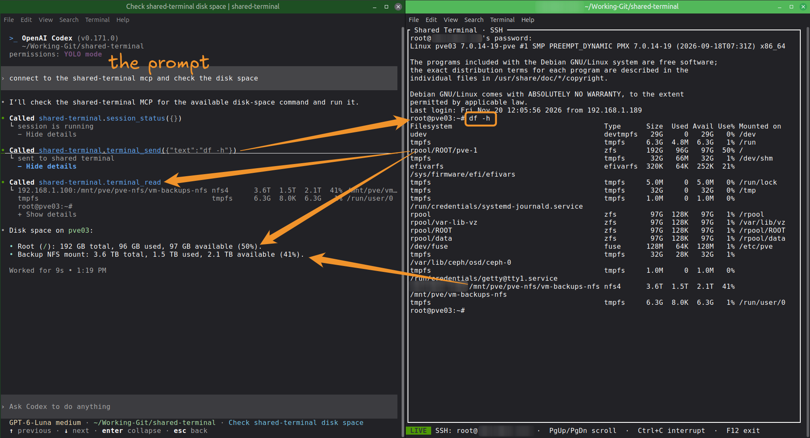

# shared-terminal

`shared-terminal` is a local, single-user bridge (MCP service) for sharing one live terminal
session with a coding agent session with the intent of having clear visibility into what 
commands the agent is sending to the remote host as well as being able to interact
and type your own commands into the shared terminal when needed. 

Start your local shell to connect to a remote host over SSH in the visible TUI. 
Give the agent session pompts to connected through the MCP to read recent terminal
output and send text instructions. Commands run with the permissions of the 
active local or remote account. 

Keep the conversation in your agent session (TUI or GUI).

`shared-terminal` is not a chat client.

Run the TUI and MCP server as the same user on the same machine. The app uses
your system SSH client, does not store SSH credentials, supports one shared
session at a time, and does not keep a terminal transcript after the TUI exits.

## Expected Workflow (after installation)

1. Open two terminals.
2. In first terminal, start `shared-terminal --local` or `shared-terminal root@192.168.1.190` (maybe snap it to the right side of your screen)
    - if starting a ssh session, you may be propted for your password next
3. In second terminal, start your agent (i.e. `codex` or `claud`, etc...) (maybe snap it to the left side of the screen)
    - tell your agent to connect to the shared-terminal mcp (the mcp should have previously been registered during install)
    - once connected, give your agent a prompt for the shared terminal (i.e. `check the disk health`)

The user is expected to prompt the agent via the agent session but also interact with the shared terminal manually entering commands or typing in passwords or pasteing tokens, while also having visibility to the agents actions, i.e. when troublshooting or running routine maintenance.

I hope you get the point. Use this for visiblity into agents working in your ssh or local environments.



.

## Requirements

- Linux or another Unix-like system with a working terminal
- Rust and Cargo
- OpenSSH client (`ssh`) for remote sessions
- Codex CLI, if you want to connect the MCP server to Codex

SSH sessions use your normal SSH config, keys, agent, and host key checks. The
app does not store SSH credentials.

## Install

From the repository root, run the installer to build and force-update the
executable, install the man page, and register or refresh the Codex MCP entry:

```sh
./install.sh
```

Cargo installs it as `~/.cargo/bin/shared-terminal`. Add Cargo's bin directory
to `PATH` so you can run `shared-terminal` directly:

```sh
echo 'export PATH="$HOME/.cargo/bin:$PATH"' >> ~/.bashrc
source ~/.bashrc
```

If you use a shell other than Bash, add `~/.cargo/bin` to that shell's startup
file instead. The installer puts the man page in your user man directory; view
it with:

```sh
man shared-terminal
```

## Register MCP with Codex

`./install.sh` registers or refreshes this MCP entry automatically. To register
it manually:

```sh
codex mcp add shared-terminal -- "$HOME/.cargo/bin/shared-terminal" mcp
```

If Codex is already running you need to exit and restart Codex after registering. 
Start `shared-terminal --local` 
or `shared-terminal user@host` in a visible terminal, then use Codex in that same
user account. The agent and person share that live session:

1. `session_status` checks that the visible TUI is running.
2. `terminal_read` reads up to 120 recent lines from the rendered terminal.
3. `terminal_send` types the supplied text into the session and presses Enter.
   It runs locally in local mode or on the remote host in SSH mode, and is
   visible in the TUI.

The agent can use `terminal_read` to inspect command output, then send follow-up
commands with `terminal_send`. The MCP server cannot create or reconnect an SSH
session; start the visible TUI first. The MCP server only exposes terminal
controls. It does not provide chat or start a separate Codex conversation.

## Start a local session

Start a shared local shell:

```sh
shared-terminal --local
```

The app runs your configured `$SHELL` interactively inside the TUI. You and the
agent share that local shell, so commands sent by the agent run on your machine
as your user.

## Start a SSH session (most common intended use)

To connect to a remote host, pass an SSH destination. Run the TUI in the
foreground in a terminal window to keep the session visible and available to
the MCP tools:

```sh
shared-terminal root@server
```

SSH options go after `--` and are passed directly to `ssh`:

```sh
shared-terminal root@server -- -p 2222 -i ~/.ssh/work_key
```

### Alternatively while working with the code, use `cargo run`

```
cargo run -- root@192.168.1.95
```

## shared-terminal Commands

You may type into the shared-terminal normally as with any other terminal. 

- `Ctrl+C` sends an interrupt to the active process. 
- `Page Up` and `Page Down` scroll the displayed terminal. 
- `F12` exits the TUI and closes its shell or SSH process. 

Run one session at a time for your user.

## Once a session is started...

Give your agent a prompt regarding the shared terminal session:

i.e.

```
Use the shared-terminal mcp to check disk space on the connected machine. Don’t make changes unless asked.
```

---

---

## After making changes to the code, Rebuild and refresh the Codex MCP registration

After changing the code, run the installer again to rebuild and replace the
executable, reinstall the man page, and remove and recreate the Codex MCP
entry:

```sh
./install.sh
```

Restart Codex after re-registering so it starts the updated MCP server. The
installer removes the existing entry first because `codex mcp add` has no
`--force` option. Start a fresh terminal session with
`shared-terminal --local` or `shared-terminal user@host` to use the newly
installed TUI as well.

## Security and secrets

MCP can read recent rendered terminal output and send text to the active shell.
Commands run with the permissions of that shell: your local user in local mode,
or the connected account in SSH mode. An agent can therefore read files and
environment variables that account can access by running shell commands.

Do not paste tokens, passwords, or other secrets into commands or other
terminal input that may be echoed. If a secret appears in rendered output, MCP
can read it. Standard no-echo password prompts normally do not display the
typed password, but avoid relying on that as a way to share secrets. The app
does not provide a separate token or password store.

The same tools are available through the local CLI while a TUI session is
running:

```sh
shared-terminal status
shared-terminal read                 # latest 120 lines
shared-terminal read --lines 40
shared-terminal send 'uptime'
```

For full options, run `shared-terminal --help`, `shared-terminal read --help`,
or `shared-terminal send --help`. Codex MCP configuration is shared by the
Codex CLI, desktop app, and IDE extension. See the
[Codex MCP guide](https://developers.openai.com/codex/mcp/) for details.

